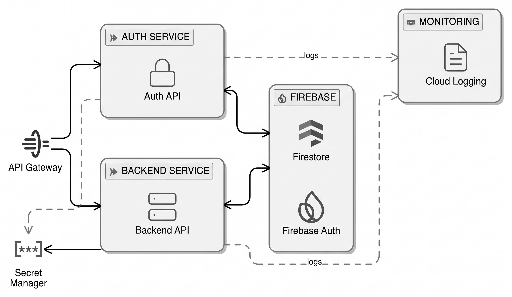

# *Cold Start* no Google Cloud Run: latência × custo

Este repositório traz o código para reproduzir o experimento de um TCC sobre o **custo de evitar o *cold start*** no Google Cloud Run. Uma aplicação de microsserviços em Python roda sob tráfego intermitente em três configurações de provisionamento. Para cada uma, o experimento compara o cumprimento de um SLO de latência com o custo faturado.

> **Pergunta:** sob tráfego intermitente, quando vale a pena pagar por uma instância mínima ociosa, ou pelo *Startup CPU Boost*, para cumprir o SLO?

- **Artigo:** _referência a incluir_.
- **Dados brutos:** _DOI a incluir_. São as saídas do k6 de cada bateria, em CSV comprimido.

## Cenários

| Cenário | Configuração | O que avalia |
|---|---|---|
| **A** | Escala a zero (`min-instances=0`) | Linha de base: paga só pelo uso, sofre *cold start* |
| **B** | Instância mínima ociosa (`min-instances=1`) | Evita o *cold start*, mas paga pela instância parada |
| **C** | Escala a zero com *Startup CPU Boost* | Encurta a inicialização por um custo extra pequeno |

Os demais parâmetros são iguais nos três cenários:
- ambiente de 2ª geração;
- cobrança por requisição (`--cpu-throttling`);
- 1 vCPU e 512 MiB;
- concorrência de 80 e *timeout* de 60 s;
- `max-instances=2`.

Os cenários usam a mesma imagem, implantada pelo *digest*, e recebem a mesma carga ao mesmo tempo.

## Resultados do artigo

Os números abaixo vêm de três baterias de 12 h na us-central1, com pausa de 30 min entre os ciclos de tráfego, e usam o SLO de 99% das requisições em até 500 ms.

| | A (escala a zero) | B (instância mínima) | C (CPU Boost) |
|---|---|---|---|
| SLI (IC 95% entre níveis) | 97,89–98,27% | **99,10–99,30%** | 98,39–98,56% |
| p99 | 3,7–4,7 s | **131–159 ms** | 26–39% menor que o do A |
| Cumpre o SLO? | Não | **Sim** | Não |
| Custo | Referência | +US$ 0,57/dia | ~+5% |

- **A mediana e o p95 quase não mudam entre os cenários:** a mediana ficou entre 35 e 43 ms e o p95 abaixo de 80 ms. O *cold start* aparece na cauda.
- **O efeito do *cold start* vai além da requisição que o dispara:** as requisições que chegam enquanto a instância inicializa esperam na fila e também violam o SLO.
- **A conclusão vale para essas condições:** uma região, uma aplicação Python/FastAPI, esse padrão de carga e o limite de 2 instâncias.

Uma campanha posterior repete o experimento em três regiões (us-central1, us-east1 e us-east4) e varia o tempo ocioso entre os ciclos. Os resultados dela ainda não foram publicados.

## Arquitetura



| Componente | Função |
|---|---|
| **API Gateway** (GCP) | Ponto de entrada; um *gateway* por cenário, gerado do mesmo template OpenAPI (`infra/gateway/openapi.tmpl.yaml`) |
| **Auth Service** (FastAPI) | Login e verificação de *token* com o Firebase Auth; serviço leve |
| **Backend Service** (FastAPI) | CRUD de postagens no Firestore; inicialização mais pesada |
| **Secret Manager** | Chave da API do Firebase, lida na inicialização |
| **VM do k6** | Gerador de carga na mesma região dos serviços |

Os serviços são privados e só o gateway pode invocá-los. O *token* do cliente chega aos serviços no cabeçalho `X-Forwarded-Authorization`.

### Instrumentação do *cold start*

O middleware em `services/comum/coldstart.py` acrescenta três cabeçalhos a cada resposta:

| Cabeçalho | Significado |
|---|---|
| `X-Cold-Start` | `1` na primeira requisição atendida pela instância |
| `X-Instance-Id` | Identificador da instância |
| `X-Instance-Age-Ms` | Tempo desde o carregamento do módulo |

A partir da idade e da latência, a análise identifica as requisições que **chegaram** quando a instância tinha menos de 10 s de vida, inclusive as que esperaram na fila e foram marcadas como quentes. O tempo de inicialização vem da métrica `container/startup_latencies` do Cloud Monitoring.

## Protocolo de carga

- **Bateria:** 18 ciclos de 10 min de tráfego, intercalando 2, 8 e 18 req/s, cada um seguido de uma pausa sem tráfego (`PAUSA_CICLO_MIN`, 30 min no artigo).
- **Modelo aberto:** o k6 usa `constant-arrival-rate`, então a lentidão do sistema não reduz a taxa de chegada.
- **Mistura de requisições:** 30% de autenticação (2/3 de `verify` e 1/3 de `login`) e 70% de CRUD de postagens (70% de leitura e 30% de escrita), em `load/bateria.js`.
- **Execução:** um processo k6 por cenário, os três em paralelo. Cada requisição recebe as tags `cenario`, `nivel`, `ciclo`, `servico`, `operacao` e `cold`.

## Estrutura

| Pasta | Conteúdo |
|---|---|
| `services/` | Auth e Backend (FastAPI), instrumentação, Dockerfiles e testes |
| `infra/` | Scripts `gcloud` de preparação, *build*, *deploy*, gateways, VM do k6, *seed* e remoção |
| `load/` | Roteiro do k6 e scripts de bateria (`run-bateria.sh`) e campanha (`run-campanha.sh`) |
| `analysis/` | Carga dos CSVs, latência e SLO, inicialização, custo, gráficos e testes |

## Como reproduzir

### Pré-requisitos

- **Projeto na GCP:** com faturamento ativo e cota de Cloud Run de pelo menos 20 vCPU na região. Com `max-instances=2`, os 6 serviços cabem nessa cota.
- **Firebase:** projeto vinculado ao mesmo projeto da GCP, com o login por e-mail e senha ativado.
- **Ferramentas:** `gcloud` autenticado (`gcloud auth login` e `gcloud auth application-default login`), Docker e [uv](https://docs.astral.sh/uv/).

> **Custo:** cada bateria de 12 h com os três cenários custou cerca de R$ 14 (~US$ 2,60) em uma região, incluindo API Gateway, Firestore e VM. Rode `infra/90-teardown.sh` ao terminar.

### Passo a passo

```bash
# 0. testes locais
(cd services && uv venv -p 3.12 && uv pip install -r requirements-dev.txt && .venv/bin/pytest tests)
(cd analysis && uv venv -p 3.12 && uv pip install -r requirements.txt && .venv/bin/pytest tests)

# 1. conta e projeto usados pelos scripts (independentes da configuração ativa do gcloud)
cp infra/conta.env.exemplo infra/conta.env       # e preencha

# 2. projeto: APIs, contas de serviço, bucket, segredo e alerta de orçamento (uma vez)
#    siga os passos manuais que o script imprime, como a exportação do faturamento para o BigQuery
FIREBASE_WEB_API_KEY=... BILLING_ACCOUNT=... ORCAMENTO=... MOEDA=BRL infra/00-setup.sh

# 3. imagens, cenários e gateways
infra/10-build.sh
for c in a b c; do infra/20-deploy.sh $c && infra/30-gateway.sh $c; done

# 4. usuários de teste, postagens e VM do k6
SENHA_TESTE=... uv run --with firebase-admin python infra/50-seed.py --usuarios 300
infra/40-vm-k6.sh       # copie load/ para a VM e crie load/config.env a partir de config.env.exemplo

# 5. na VM, dentro de um tmux, com o B ligado (infra/cenario-b.sh liga)
load/run-bateria.sh 1 --smoke      # bateria curta de validação (~25 min)
load/run-campanha.sh 1 3           # baterias de 12 h em sequência, enviadas ao bucket

# 6. ao final
infra/cenario-b.sh desliga && infra/90-teardown.sh
```

**Outras regiões:** use `REGIAO=us-east1 infra/<script>`. Cada região tem os próprios serviços, gateways, banco e VM (`infra/env.sh`); a preparação regional é `REGIAO=... infra/00-setup.sh --regiao`.

**Outra pausa entre ciclos:** mude `PAUSA_CICLO_MIN` no `load/config.env` da VM. A pausa vai como tag `pausa` em cada medição.

## Como refazer a análise

A análise roda sobre os dados brutos, tanto do seu bucket quanto do pacote de dados publicado:

```bash
A=analysis/.venv/bin/python
$A analysis/carregar.py dados/*-b* -o results/latencia.parquet
$A analysis/latencia.py results/latencia.parquet -o results/tabelas --por-regiao
$A analysis/startup.py --inicio 2026-11-01T00:00:00Z --fim 2026-11-02T18:00:00Z -o results/startup
$A analysis/custo.py results/tabelas/sli.csv --faturamento PROJETO.DATASET.TABELA --inicio AAAA-MM-DD --fim AAAA-MM-DD
$A analysis/graficos.py --tabelas results/tabelas --custo results/custo --latencia results/latencia.parquet -o results/figuras
```

O `startup.py` e o `custo.py` consultam o Cloud Monitoring e o faturamento do seu próprio projeto. Os demais scripts só leem os CSVs.

| Tabela (`latencia.py`) | Conteúdo |
|---|---|
| `sli.csv`, `sli_servico.csv`, `sli_bateria.csv` | SLI por cenário, nível, serviço e bateria |
| `percentis.csv`, `percentis_ic.csv` | p50, p95 e p99, com IC 95% por *bootstrap* |
| `mann_whitney.csv` | Teste de Mann-Whitney e delta de Cliff entre os pares de cenários |
| `cv_baterias.csv` | Coeficiente de variação entre baterias |
| `impacto_cold.csv`, `impacto_sensibilidade.csv` | Violações atribuídas a *cold start*, com cortes de 5, 10 e 30 s |
| `login.csv` | Falhas de *login* no Firebase |

**Decisões de análise:**
- **Login fora do SLI principal:** o `POST /auth/login` fica de fora porque o Firebase limita as verificações de senha por conta. As falhas vão para `login.csv`.
- **Iterações descartadas:** as que o k6 não conseguiu disparar contam como violação do SLO e ficam fora dos percentis.
- **Tamanho de efeito:** com ~100 mil requisições por cenário, quase toda diferença é significativa, então a análise reporta também o delta de Cliff.

## Licença

O código está sob a licença MIT (`LICENSE`).
